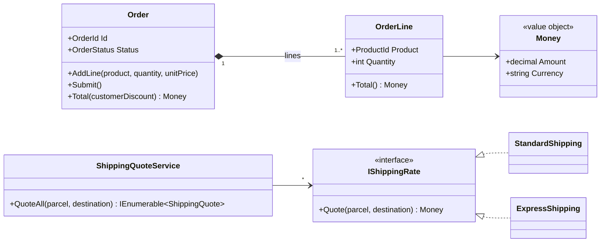
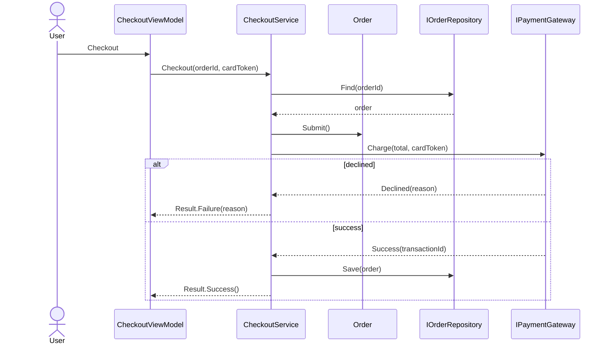

# Design output and diagrams

A design proposal has four parts, in this order. Keep it as short as the change allows;
a small change may need only the table and one diagram.

1. **Responsibilities table**: every new or changed class, one line each.
2. **Class diagram** (Mermaid): the classes, their key members, and relationships.
3. **Sequence diagram** (Mermaid), when the interaction has more than a few steps,
   crosses layers, or involves asynchronous or failure paths.
4. **Decisions and open points**: patterns used and why, alternatives rejected, error
   handling, and every question still open for the developer.

## Responsibilities table

| Class | Kind | Responsibility | Collaborators |
|-------|------|----------------|---------------|
| `Order` | Entity, aggregate root | Holds lines and status; enforces that only open orders change | `OrderLine`, `Money` |
| `ShippingQuoteService` | Application service | Quotes every registered carrier for a parcel | `IShippingRate` |
| `IShippingRate` | Interface (strategy) | Quotes one carrier's price | |
| `StandardShipping` | Strategy | Standard carrier's rate rules | |

"Kind" uses the vocabulary of these references: entity, value object, aggregate root,
domain service, application service, repository, adapter, strategy, and so on.

## Class diagram



Conventions:

- Show only members that matter for the design (public operations and key data); not
  every property.
- Parameters by name only, return type after the parentheses; generics with `~T~`.
- Stereotypes: `<<interface>>`, `<<abstract>>`, `<<value object>>`, `<<entity>>`,
  `<<service>>`, `<<repository>>` where the kind is not obvious.
- Relationships:

| Mermaid | Meaning | Use for |
|---------|---------|---------|
| `A <\|-- B` | B inherits A | Class inheritance |
| `A <\|.. B` | B implements A | Interfaces |
| `A *-- B` | A owns B (composition, same lifetime) | Aggregate root and its parts |
| `A o-- B` | A has B (aggregation, independent lifetime) | Rare; prefer association |
| `A --> B` | A uses or references B | Dependencies, collaborators |
| `A ..> B` | A depends on B temporarily | Parameters, created objects |

- Mark new classes and changed classes in the responsibilities table, not with colors.
- Split diagrams with more than about twelve classes, by layer or by feature.

## Sequence diagram



- Participants are objects by role (`IOrderRepository`, not `SqlOrderRepository`)
  unless the implementation matters.
- Show failure paths with `alt` / `else`; that is often where the design is decided.
- Return arrows (`-->>`) only where the returned value matters.

## Decisions and open points

```markdown
### Decisions
- Shipping carriers use Strategy (`IShippingRate`): two carriers now, a third planned.
- Declined payments return `Result` (expected outcome); gateway outages throw
  `PaymentGatewayUnavailableException` (handled by the screen as "try again later").

### Open points
1. Should a declined payment reopen the order, or leave it submitted for a retry?
2. Is the bulk discount per line or per order total?
```

Do not resolve open points by assumption; ask the developer, and update the design
when they answer.
