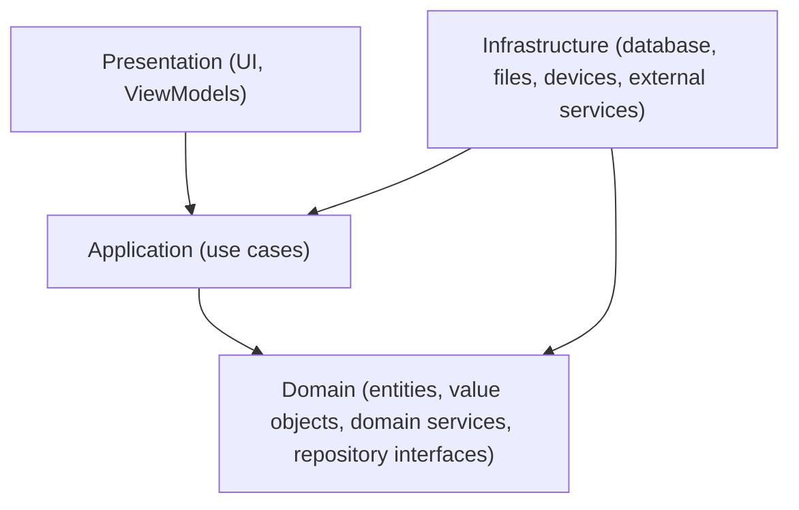

# Domain model

A light version of domain-driven design: enough structure to keep business rules in
one place and valid, without the full methodology. C# 7.3 syntax.

## Building blocks

| Kind | Identity | Mutable | Equality | Examples |
|------|----------|---------|----------|----------|
| **Entity** | Has an id that stays the same over its life | Yes, through methods that keep it valid | By id | `Order`, `Customer`, `Invoice` |
| **Value object** | None; defined by its values | No | By all values | `Money`, `Address`, `DateRange`, `OrderId` |
| **Aggregate** | The root entity's id | Changed only through the root | By root id | `Order` with its `OrderLine`s |
| **Domain service** | None | Stateless | n/a | `PriceCalculator`, `TaxRules` (rules that span several aggregates) |

## Value objects

Replace primitive fields that carry rules (amount + currency, a range, an id) with
small immutable types. They remove whole classes of bugs (adding euros to dollars,
swapping two `int` ids) and give rules a home.

```csharp
public sealed class Money : IEquatable<Money>
{
    public Money(decimal amount, string currency)
    {
        if (string.IsNullOrEmpty(currency))
        {
            throw new ArgumentException("A currency is required.", nameof(currency));
        }

        Amount = amount;
        Currency = currency;
    }

    public decimal Amount { get; }
    public string Currency { get; }

    public static Money Euro(decimal amount) { return new Money(amount, "EUR"); }

    public static Money operator +(Money left, Money right)
    {
        if (left.Currency != right.Currency)
        {
            throw new InvalidOperationException($"Cannot add {right.Currency} to {left.Currency}.");
        }

        return new Money(left.Amount + right.Amount, left.Currency);
    }

    public static Money operator *(Money money, decimal factor)
    {
        return new Money(decimal.Round(money.Amount * factor, 2), money.Currency);
    }

    public bool Equals(Money other)
    {
        return other != null && Amount == other.Amount && Currency == other.Currency;
    }

    public override bool Equals(object obj) { return Equals(obj as Money); }

    public override int GetHashCode()
    {
        unchecked
        {
            return (Amount.GetHashCode() * 397) ^ Currency.GetHashCode();
        }
    }

    public override string ToString() { return $"{Amount:0.00} {Currency}"; }
}
```

- Validate in the constructor; an invalid value object never exists.
- Operations return new instances.
- Strongly typed ids (`OrderId` wrapping a `Guid` or `int`) prevent passing the wrong
  id; use them for aggregate ids in larger models.
- Newer C# (9+) can declare value objects as `record` types with generated equality;
  keep the class form in C# 7.3 projects.
- `Equals(Money other)` uses `other != null`, which calls the overloaded operator if one
  is added later; when you add `==` / `!=` operators, compare with
  `ReferenceEquals(other, null)` inside them.

## Entities

```csharp
public sealed class Order
{
    private readonly List<OrderLine> _lines = new List<OrderLine>();

    public Order(OrderId id, CustomerId customer)
    {
        Id = id;
        Customer = customer;
        Status = OrderStatus.Open;
    }

    public OrderId Id { get; }
    public CustomerId Customer { get; }
    public OrderStatus Status { get; private set; }
    public IReadOnlyList<OrderLine> Lines => _lines;

    public void AddLine(ProductId product, int quantity, Money unitPrice)
    {
        EnsureOpen();
        if (quantity <= 0)
        {
            throw new ArgumentOutOfRangeException(nameof(quantity), "Quantity must be positive.");
        }

        OrderLine existing = _lines.FirstOrDefault(l => l.Product.Equals(product));
        if (existing != null)
        {
            existing.Increase(quantity);
        }
        else
        {
            _lines.Add(new OrderLine(product, quantity, unitPrice));
        }
    }

    public void Submit()
    {
        EnsureOpen();
        if (_lines.Count == 0)
        {
            throw new InvalidOperationException("Cannot submit an empty order.");
        }

        Status = OrderStatus.Submitted;
    }

    private void EnsureOpen()
    {
        if (Status != OrderStatus.Open)
        {
            throw new InvalidOperationException($"Order {Id} is {Status} and cannot be changed.");
        }
    }
}
```

- State changes are methods named for the business action (`Submit`, `AddLine`), not
  public setters.
- Collections are exposed read-only; changes go through the entity.
- Rule violations caused by a caller bug or a stale UI are exceptions; rules the user
  can break by normal input are checked first and reported (see
  [error-handling.md](error-handling.md)).
- ORMs that need setters or parameterless constructors can use `private` ones; do not
  make the model public-mutable for the ORM's sake.

## Aggregates

An aggregate is a cluster of objects changed together, with one root that guards the
invariants of the whole cluster.

- Outside code holds references only to the root. `OrderLine` is changed through
  `Order`, never directly.
- Other aggregates are referenced by id (`CustomerId`), not by object, so loading an
  order does not load the customer graph and the boundaries stay clear.
- One transaction changes one aggregate in the normal case. Rules that span aggregates
  are checked by a domain or application service, or settled afterwards.
- Keep aggregates small: include only what must be consistent at every moment. "The
  order total must match its lines" belongs in the order; "the customer's credit limit
  covers all open orders" usually does not.

## Layers and dependency direction



- **Domain** has no references to UI, database, file system, or frameworks. It defines
  the interfaces it needs (`IOrderRepository`, `IClock`).
- **Application** coordinates a use case: load aggregates, call domain methods, save,
  notify. It holds no business rules of its own.
- **Infrastructure** implements the interfaces. **Presentation** calls application
  services.
- Arrows point inward: outer layers depend on inner ones, never the reverse. A domain
  class that needs something from outside gets an interface.
- In small applications the layers can be folders in one project; split into projects
  when the dependency rule needs to be enforced by the compiler.
- For a WPF client, the ViewModels are the presentation layer (`ss-wpf:mvvm`); the
  services they call are the application layer.

## When a full domain model is too much

For simple data entry with few rules (forms that save what was typed), a transaction
script or plain data classes with a validation step is enough. Say which one the
design uses and why; move to a domain model when rules start repeating across use
cases.
