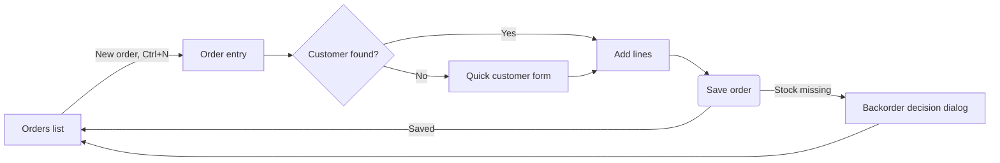
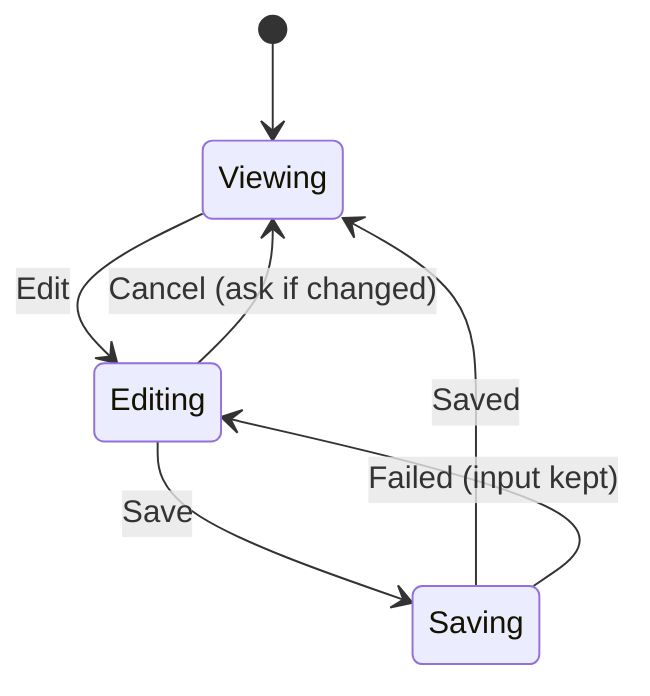

# Information architecture and flows

Decide what screens exist, how users move between them, and what each screen shows in
every state, before drawing any layout.

## Start from tasks

List the tasks before the screens. One row per task:

| Task | Who | How often | Direction | Notes |
|------|-----|-----------|-----------|-------|
| Enter a phone order | Order clerk | 200 a day | Use | Customer on the phone; speed matters |
| Find an order and change the delivery date | Order clerk | 30 a day | Use | Starts from a customer name or order number |
| Export the yearly sales report | Team lead | Twice a year | Learn | Exception screen |

- Frequent tasks get the shortest path and the most prominent place.
- Rare tasks may be deeper, but must be findable by name (menu, settings, search).
- A task that crosses several screens is a flow; draw it (see below).

## From tasks to screens

- **One main task per screen.** A screen can support related secondary tasks, but its
  layout serves the main one.
- **Group by task, not by data.** "Order entry" and "Delivery planning" are screens;
  "Customers table" and "Orders table" are usually not, unless browsing that data is
  the task.
- **Name screens by what users do or look at**, in their words ("Orders",
  "Delivery plan"), not by internal module names.

## Desktop navigation patterns

| Pattern | Fits | Easy to use | Easy to learn |
|---------|------|-------------|---------------|
| Main window with sidebar or tabs | Several areas used during the day | Always visible, keyboard switchable (Ctrl+1..9, Ctrl+Tab) | Few top-level items (5-7), clear names |
| Master-detail (list plus details pane) | Browse, find, and edit items | List and details on one screen, edit in place | Details pane or separate page with a clear Edit mode |
| Document tabs | Several items open at once | Useful for comparing and for interruptions | Avoid unless the task needs it |
| Wizard (steps) | Rare, multi-step, order matters | Avoid for frequent tasks; offer one form instead | Good: one decision per page, summary before finish |
| Modal dialog | A short decision or input that blocks the current task | Keep short; Enter and Esc work | Explain the consequence in the dialog |
| Modeless window or panel | Tools used alongside the main work | Dockable, remembers position | Avoid floating windows that get lost |

Rules for all directions:

- Frequent tasks are reachable from the main window without opening a dialog chain.
- Modal dialogs are for decisions and short input only, never for browsing or long
  forms; never stack more than one modal dialog on another.
- Every screen has a way back or out (Cancel, Close, Back) that does not lose work
  silently; ask before discarding changes, or keep a draft.
- No dead ends: an empty, error, or no-permission state says what the user can do next.
- Windows remember their size, position, splitter positions, and column widths between
  sessions; they open on a visible monitor.

## Flows

Draw a flow when a task crosses screens, branches, or has failure paths. Use a Mermaid
flowchart with screens as rectangles, decisions as diamonds, and system steps as
rounded boxes:

- Mark which steps are frequent and which are exceptions; optimize the frequent path.
- Show failure and cancel paths; that is where most design decisions are.
- Count the steps of the frequent path (easy to use) or the decisions per step (easy to
  learn) and say so in the design.

## Screen states

Design every state that the screen can be in. List them in the component and state
table of the design output:

| State | Design it as |
|-------|--------------|
| First use / empty | Says why it is empty and offers the next action ("No orders today. Press Ctrl+N to enter one.") |
| Loading | Keeps the layout stable (placeholders or a busy indicator in the area that loads); the rest stays usable when possible |
| Normal | The main layout |
| Partly loaded or large data | Paging or virtualization, a count ("Showing 200 of 3,412"), and a way to narrow down |
| No results (after search or filter) | Different from empty: shows the active filter and a way to clear it |
| Error | Says what failed, keeps what the user entered, offers retry or an alternative |
| Read-only or locked | Visibly read-only (not just disabled-looking), with the reason ("Shipped orders cannot be changed.") |
| No permission | Hide what the user can never use; show and explain what they could get access to |
| Offline or device not connected | Shows the condition and what still works |

For screens with several modes (view, edit, busy), a Mermaid state diagram makes the
transitions clear:

