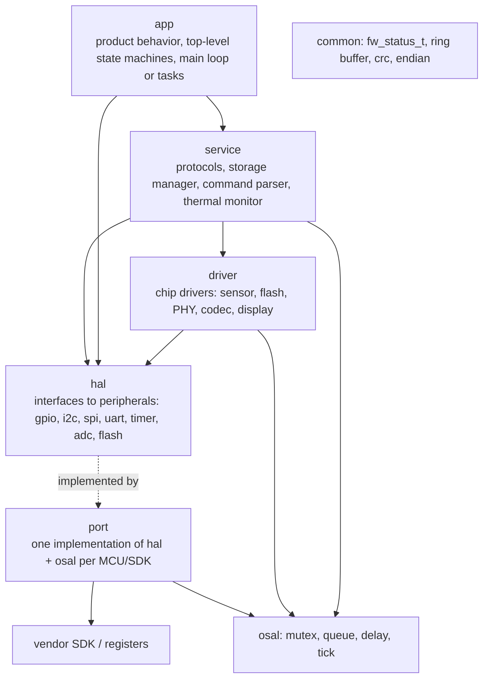

# Layers and dependency rules

Contents: the layers · the dependency rule · folder layout · composition root · mapping to
each SDK · deciding which layer code belongs to · design output format

## The layers



| Layer | Owns | May include | Must not |
|-------|------|-------------|----------|
| **app** | what the product does: modes, workflows, wiring of objects | service, driver, hal, osal, common | touch registers; call vendor SDK |
| **service** | reusable logic with its own state: protocol framing, storage, scheduling, thermal monitor | driver, hal, osal, common | include a chip driver's private header; call vendor SDK |
| **driver** | one external device (or one on-chip block treated as a device): its registers, commands, conversions | hal (interfaces), osal, common | include a vendor header; know which MCU it runs on |
| **hal** | the interface to a peripheral class, as a header with an ops table | common | include a vendor header; contain logic |
| **port** | the implementation of hal and osal for one MCU/SDK | vendor SDK, hal, osal, common | contain product logic or device knowledge |
| **osal** | RTOS primitives behind a header (mutex, queue, delay, tick); bare-metal build provides stubs | common | leak `xQueueHandle`, `k_msgq`, `tx_*` in its signatures |
| **common** | status codes, macros, ring buffer, CRC, endian helpers | the C library | include anything else |
| **board** | pin map, clocks, board init, generated code | vendor SDK, port | contain logic |

Naming the layer in the file name (`drv_tmp102.c`, `svc_storage.c`, `port_stm32_i2c.c`,
`hal_i2c.h`) lets a reviewer see a violation from the include list alone.

## The dependency rule

1. **Down only.** A file includes headers from its own layer or below. A lower layer
   reaches a higher one through a callback or an event, never an include.
2. **Skipping layers is fine, going up is not.** `app` may use a `hal_gpio` directly for
   an LED; a driver may not call an app function.
3. **Vendor headers live in port and board only.** Grep for `stm32`, `esp_`, `driver/`,
   `fsl_`, `zephyr`, `cyu3`, `freertos` outside those folders; every hit is a layering
   violation or a missing port function.
4. **No cycles.** Two modules that include each other need a third (an interface) that
   both depend on.
5. **Interfaces are owned by the consumer.** The driver layer declares what it needs from
   a bus (`hal_i2c_ops_t`); the port adapts to it, not the other way round. The sensor
   interface in `templates/drivers/sensor.h` is owned by the service that consumes it.

## Folder layout

```
firmware/
  app/               main.c, product state machines, composition root (app_init.c)
  services/          svc_*.c/.h
  drivers/           drv_*.c/.h             chip drivers (no vendor includes)
  hal/               hal_*.h                interfaces only (+ tiny inline wrappers)
  osal/              osal.h                 interface; osal_freertos.c, osal_zephyr.c, osal_none.c
  ports/
    esp32/           port_esp32_i2c.c, port_esp32_gpio.c ...
    stm32/           port_stm32_i2c.c ...
    nrf/             port_nrf_*.c
    nxp/             port_nxp_*.c
  board/             board_<name>.c/.h      pin map, which port object is which bus
  common/            fw_common.h, ring_buffer.[ch], crc.[ch]
  tests/             host tests, mocks, fakes
  third_party/       vendor SDKs and libraries, unmodified
```

Only the ports and board folders of the chosen target are built; the layers above are
the same files for every target. In a repository that already has a layout (ESP-IDF
`components/`, a Zephyr module, CubeMX `Core/`), keep the layout and map the layers onto
it; see the platform file. The point is the include rule, not the folder names.

## Composition root

Objects are created and connected in **one place**, usually `board/` plus `app/app_init.c`.
Nothing else instantiates a port or chooses a bus.

```c
/* board_devkit.c - the only place that knows which bus the sensor is on. */
static port_stm32_i2c_t s_i2c1;
static tmp102_t         s_temp_sensor;
static thermal_monitor_t s_thermal;

fw_status_t board_init(void)
{
    port_stm32_i2c_config_t bus_cfg = { .handle = &hi2c1, .lock = NULL };
    tmp102_config_t sensor_cfg;
    thermal_monitor_config_t mon_cfg;
    fw_status_t st;

    st = port_stm32_i2c_init(&s_i2c1, &bus_cfg);
    if (st != FW_OK) { return st; }

    sensor_cfg.bus = port_stm32_i2c_as_hal(&s_i2c1);
    sensor_cfg.address = TMP102_ADDR_ADD0_GND;
    sensor_cfg.timeout_ms = 0u;
    st = tmp102_init(&s_temp_sensor, &sensor_cfg);
    if (st != FW_OK) { return st; }

    mon_cfg.sensor = tmp102_as_sensor(&s_temp_sensor);
    mon_cfg.high_milli_c = 60000;
    mon_cfg.hysteresis_milli_c = 5000;
    mon_cfg.fault_limit = 3u;
    mon_cfg.on_event = app_on_thermal_event;
    mon_cfg.ctx = NULL;
    return thermal_monitor_init(&s_thermal, &mon_cfg);
}
```

Why one place: moving the sensor to another bus, or running on a different board, edits
one file; and a reader finds every dependency without chasing globals. Initialization
order is explicit (bus before device before service) and a failure stops the chain with a
status instead of a half-initialized system.

## Mapping onto each SDK

| SDK | Where the layers go | The seam |
|-----|---------------------|----------|
| ESP-IDF | one component per module or layer (`CMakeLists.txt` with `idf_component_register`); ports are a component that `REQUIRES` the IDF drivers | `REQUIRES` / `PRIV_REQUIRES` in the component list enforces the include rule |
| STM32 CubeMX | `Core/` and `Drivers/` stay generated; your layers sit beside them in their own folders; ports include `main.h` or the HAL headers | `USER CODE` regions call `board_init()` and `app_run()` only |
| nRF Connect SDK | the app is a Zephyr application or module; Zephyr's device API is already the HAL; ports adapt only what you need to fake | devicetree selects the device, `DEVICE_DT_GET` is the composition |
| MCUXpresso SDK | generated `board/pin_mux.c`, `clock_config.c`, `peripherals.c` stay generated; ports wrap `fsl_*` drivers | `BOARD_Init*` calls in main, then your `board_init()` |
| FX2LP | files and naming discipline; the HAL is macros or inline code, not ops tables (RAM and call depth) | see [platform-fx2.md](platform-fx2.md) |
| FX3 | `main()` builds threads in `CyU3PApplicationDefine`; app thread owns the objects; USB and DMA callbacks signal it | see [platform-fx3.md](platform-fx3.md) |

## Which layer does this code belong to?

Ask in this order and stop at the first yes:

1. Does it call a vendor function or touch a register of the MCU? -> **port** (or board).
2. Does it know the registers, commands, or timing of one external chip? -> **driver**.
3. Is it a reusable behavior with state that does not depend on a particular chip
   (framing, retries, storage layout, scheduling)? -> **service**.
4. Is it a decision particular to this product (which pin is the alarm LED, what to do
   at over-temperature)? -> **app**.
5. Is it only a type, macro, or pure helper? -> **common**.

A function that needs two answers (a chip command and a vendor call) is two functions in
two layers.

## Design output format

When designing, give the developer:

1. **Layer map**: a table of modules by layer with one responsibility sentence each.
2. **Objects**: for each, the config struct, the object struct, and the ops table (names
   and signatures only until the design is agreed).
3. **Ownership**: who owns each peripheral, buffer, and queue; which context (task, ISR,
   main loop) calls each function.
4. **Flow**: a Mermaid sequence diagram for the interrupt-to-task path and for start-up
   order when there are more than three participants.
5. **Open points**: every question that is still unanswered (datasheet values, timing,
   failure behavior) with the default chosen if it stays unanswered.
