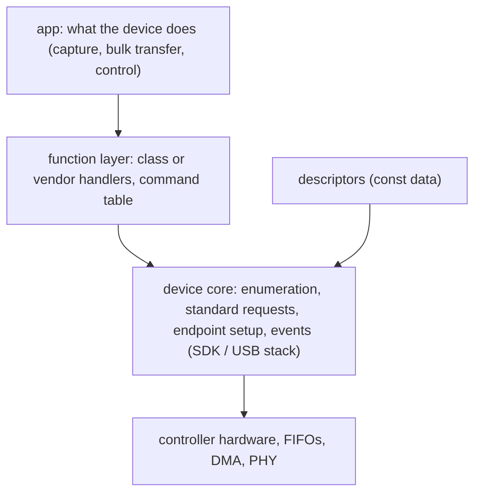

# USB device firmware: structure that holds across chips

Contents: layers of a USB device · descriptors · enumeration and control requests ·
endpoints and data flow · vendor request table · state and events · errors and recovery ·
what differs per chip

This file is chip-independent. For the controllers where USB is the product, read it
together with [platform-fx2.md](platform-fx2.md) or [platform-fx3.md](platform-fx3.md);
for USB on ESP32-S2/S3, STM32, nRF, or i.MX RT, the vendor USB stack plays the part of the
"device core" below and your code is the function layer.

## Layers of a USB device



| Layer | Responsibility | Typical content |
|-------|----------------|-----------------|
| **Descriptors** | const data only | device, configuration, interface, endpoint, string, BOS (USB 3.x), qualifier, per speed |
| **Device core** | enumeration and standard requests; reports events | provided by the SDK or stack; you register callbacks |
| **Function layer** | requests addressed to your interface: class and vendor requests | a command table, a state per interface |
| **Stream layer** | moves bulk/iso/interrupt data between endpoints and the rest of the system | endpoint config, DMA channels/FIFOs, buffers, flow control |
| **App** | policy | start/stop streaming on `SET_INTERFACE`, error reporting |

Dependency rule: descriptors and the function layer know USB but not which chip; the
device core and stream setup are the port; the app does not touch endpoints directly.

## Descriptors

- **Const tables in code space** (`const`, `__code` on 8051): never built in RAM unless a
  field is dynamic (serial number string).
- **One source of truth.** Endpoint addresses, max packet sizes, and interface numbers are
  `#define`d once and used by descriptors **and** endpoint configuration; a mismatch
  between the two is the classic "enumerates but no data" bug.
- **Per-speed descriptors**: the max packet size of a bulk endpoint depends on speed
  (full 64, high 512, SuperSpeed 1024 with a companion descriptor). Provide a set per
  speed the device supports and select by the speed the core reports.
- **Little-endian fields**, length byte exact, `wTotalLength` computed (use `sizeof` of a
  packed array, or a `static_assert`), so adding an endpoint cannot leave it stale.
- **String descriptors** are UTF-16LE with a length prefix; the serial number is unique
  per unit if the host must tell several apart.
- **Vendor/product IDs** are the customer's or a registered one; do not ship a sample VID/PID.
- Test with a descriptor dump (`lsusb -v`, USBView, a hardware analyzer) and a validator
  (USB-IF USBCV) before debugging data transfers.

## Enumeration and control requests

- **Control endpoint 0** carries the 8-byte SETUP packet (`bmRequestType`, `bRequest`,
  `wValue`, `wIndex`, `wLength`). Decode it once into a struct:

```c
typedef struct usb_setup {
    uint8_t  request_type;   /* bit 7 direction, bits 6..5 type (std/class/vendor), bits 4..0 recipient */
    uint8_t  request;
    uint16_t value;
    uint16_t index;
    uint16_t length;
} usb_setup_t;

fw_status_t usb_setup_parse(const uint8_t raw[8], usb_setup_t *out);   /* explicit LE decode */
```

- **Standard requests** (`GET_DESCRIPTOR`, `SET_CONFIGURATION`, `SET_ADDRESS`, ...) are
  handled by the core; your code sees the ones the core hands up (`SET_INTERFACE`,
  `CLEAR_FEATURE(ENDPOINT_HALT)`, class and vendor requests).
- **Every request ends one of three ways:** handled with data/status, stalled (unsupported),
  or deferred (long operation: ACK now, finish in a task). Never leave a control transfer
  unanswered; the host times out (and Windows may mark the device broken).
- **Direction and length:** check `wLength` against your buffer before a data stage; a
  device-to-host request with a short answer completes with a short packet.

## Endpoints and data flow

- **Direction names are host-centric**: IN = device to host, OUT = host to device.
- **Bulk** for throughput with no timing guarantee, **interrupt** for small periodic data
  with bounded latency, **isochronous** for fixed-rate streams (drops instead of retries).
- **Zero-length packets**: a transfer that is an exact multiple of the max packet size
  needs a ZLP (or a protocol that knows the length) to end a bulk transfer.
- **Flow control** is the part that is wrong most often: decide what happens when the
  host is slower than the source (drop, back-pressure on the source, bigger buffers) and
  when the source is slower (short transfers, timeout, flush). Count underruns and
  overruns and expose them through a vendor request.
- **Buffers and ownership**: a buffer is owned by the hardware (DMA, FIFO) or by firmware,
  never both; hand-off is a function call or a descriptor commit. Align and size for DMA
  and cache ([interrupts-concurrency.md](interrupts-concurrency.md)).
- **Reset and re-configuration** (bus reset, suspend, `SET_CONFIGURATION(0)`) must stop
  streams, flush endpoints, and return the stream layer to idle; a stream layer that only
  knows "start" leaks state across re-enumeration. Make start and stop symmetric and
  idempotent.

## Vendor request table

Vendor commands (firmware version, register read/write, start/stop, mode) are the natural
use of a command table ([oop-in-c.md](oop-in-c.md)). Keep the table in code space and the
handlers small:

```c
typedef struct vendor_cmd {
    uint8_t request;         /* bRequest */
    uint8_t direction;       /* USB_DIR_IN or USB_DIR_OUT, checked before dispatch */
    uint16_t max_length;     /* largest accepted wLength */
    fw_status_t (*handler)(void *ctx, const usb_setup_t *setup, uint8_t *data, uint16_t *len);
} vendor_cmd_t;

static const vendor_cmd_t s_cmds[] = {
    { CMD_GET_VERSION,  USB_DIR_IN,  8u, cmd_get_version  },
    { CMD_SET_MODE,     USB_DIR_OUT, 4u, cmd_set_mode     },
    { CMD_READ_REG,     USB_DIR_IN,  4u, cmd_read_reg     },
};
```

The dispatcher looks up `setup->request`, checks direction and length, calls the handler,
and either completes the data stage or stalls on `FW_ERR_NOT_SUPPORTED` /
`FW_ERR_INVALID_ARG`. A host test can feed it parsed SETUP packets and check the responses,
without a USB stack; this is the highest-value host test in a USB project.

Also define the request codes in **one shared header** used by firmware and the host
software (driver, DLL, or Python tool), so the two cannot drift.

## State and events

- Keep one `usb_state_t` (`DETACHED`, `POWERED`, `DEFAULT`, `ADDRESSED`, `CONFIGURED`,
  `SUSPENDED`) driven by the core's events (connect, reset, configured, suspend, resume,
  disconnect). The app starts and stops streaming on `CONFIGURED` and the alternate
  setting, never on an assumption.
- **Callbacks come from the SDK in a context you must look up** (ISR, driver thread, or
  your thread). Treat them as ISR-like: copy what you need, post an event to the app
  thread, return. Do the slow work (start DMA, reconfigure GPIF, flash a register map)
  in the app thread.
- **Suspend/resume and remote wake-up**: stop non-essential activity within the limit the
  spec gives for suspend current; restore state on resume.

## Errors and recovery

- Endpoint **stall** is a protocol signal, not an error to hide: stall unsupported
  requests; the host clears it with `CLEAR_FEATURE(ENDPOINT_HALT)`, which your code must
  honor by resetting the endpoint's data toggle and queue.
- **Timeouts**: bound every wait on a FIFO or DMA completion; on timeout flush, count, and
  restart the stream rather than blocking forever.
- **Unplug during transfer** must not hang the app thread: all blocking calls return when
  the core reports disconnect/reset.
- **Log** to a ring buffer readable through a vendor request: USB devices rarely have a
  console on the bench of the customer.

## What differs per chip

| Concern | FX2LP | FX3 | ESP32-S2/S3 | STM32 | nRF52840/53 | i.MX RT / LPC / Kinetis |
|---------|-------|-----|-------------|-------|-------------|-------------------------|
| Core | 8051, firmware in RAM or EEPROM | ARM926, ThreadX | TinyUSB in ESP-IDF | USB middleware (ST) or TinyUSB | Zephyr USB device stack (`usbd`) | NXP USB stack in the SDK |
| Control | SETUP registers, SUDAV interrupt | setup callback | TinyUSB callbacks | middleware class callbacks | `usbd` class and vendor request handlers | stack callbacks |
| Data path | endpoint FIFOs + GPIF, autoin/autoout | DMA channels between USB and GPIF II/other sockets | TinyUSB endpoint API | HAL PCD + middleware | `usbd` endpoint API | stack endpoint API |

Chip specifics (register names, calls, constraints) are in the platform files; the
structure above should not change.
